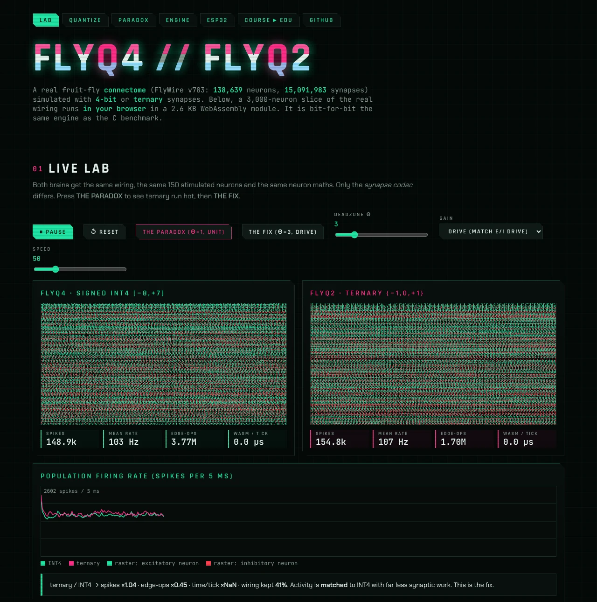
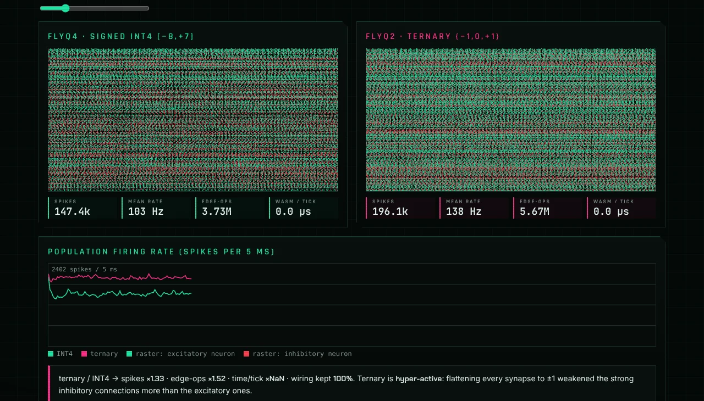
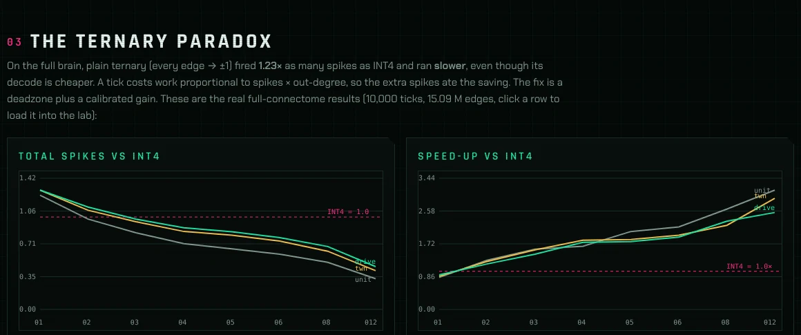
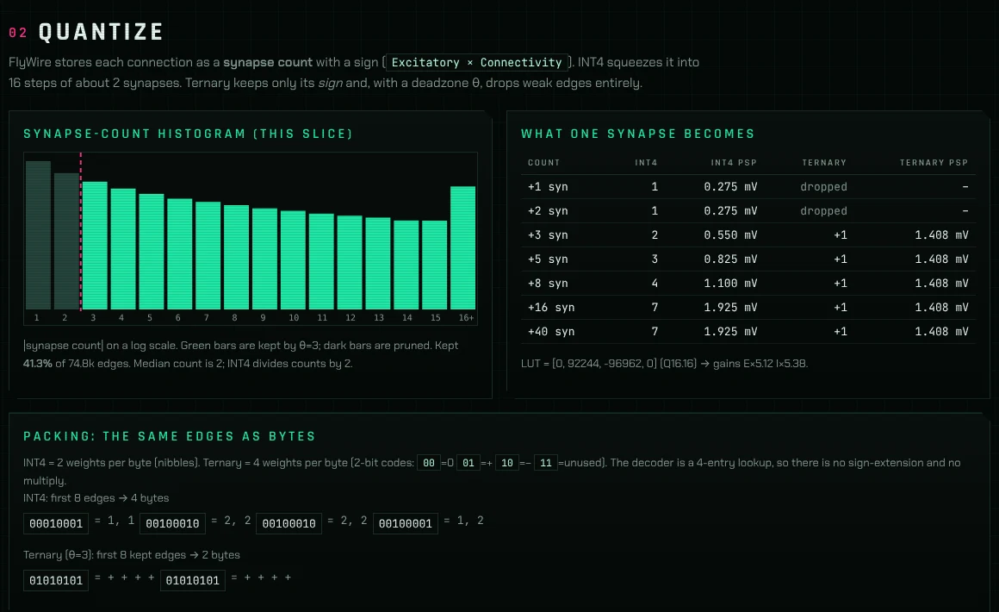

# FlyQ4 — INT4 vs ternary whole-brain *Drosophila* connectome

Simulates the FlyWire v783 connectome (138,639 neurons, 15,091,983 synapses) with a C Q16.16 integer engine and two synapse codecs: **FlyQ4** (signed INT4) and **FlyQ2** (ternary, 2-bit).

**Live demo:** <https://lucky-edgelord.github.io/FlyQ4-/> · **Course:** <https://lucky-edgelord.github.io/FlyQ4-/course.html> (needs GitHub Pages: Settings → Pages → `main` / `/docs`). Or run it locally: `python -m http.server -d docs`.



*The live lab, at the fixed setting (θ=3, drive gain): ternary matches INT4's total spikes (×1.04 on this slice) with 45% of the synaptic work.*

## The ternary paradox, fixed



*Plain ternary (θ=1, unit gain) on the same slice: ×1.33 spikes and ×1.52 synaptic work. The full brain gave ×1.23.*

The A/B notebook's ternary model was `np.sign(w)`: no threshold, every edge → ±1. It fired 1.23× the INT4 spikes and was slower. `flyq4.quant.ternarize` adds a **deadzone θ** (weak edges are removed) and **per-polarity gains** (free: they live in the 4-entry LUT). On the real data, **θ=3 + `drive` gain** gives spikes ×0.98, 1.45× faster, 33% of edges. Fidelity caveats are in [docs/ternary-paradox.md](docs/ternary-paradox.md); per-neuron rate correlation is only ≈0.63.





```sh
pip install -r requirements.txt
python scripts/threshold_sweep.py --data-dir data            # full sweep (10 min on 2 cores); --quick for a smoke test
python scripts/threshold_sweep.py --reselect results/sweep_results.json --jaccard-metric top10_jaccard --min-jaccard 0.6
```

Data: `data/2025_Completeness_783.csv` and `2025_Connectivity_783.parquet` from [eonsystemspbc/fly-brain](https://github.com/eonsystemspbc/fly-brain); downloaded automatically (an LFS-pointer stub is detected and refused, and a synthetic fallback is never substituted silently).

## Layout

| Path | What |
|---|---|
| `flyq4/engine.c`, `runtime.py`, `quant.py`, `metrics.py` | engine, ctypes wrapper, codecs, fidelity metrics |
| `scripts/threshold_sweep.py` | θ × gain sweep, CSV/JSON out |
| `docs/` | WASM demo, course, write-ups (`ternary-paradox.md`, `esp32.md`) |
| `docs/wasm/flyq_wasm.c` | freestanding C → `flyq.wasm` (2.6 KB, `clang --target=wasm32 -O3 -nostdlib …`) |
| `esp32/` | ESP-IDF component + demo app; `tools/export_esp32.py` crops a subnetwork |
| `tests/` | `python tests/test_engine.py`, `test_esp_port.py`, `node tests/test_wasm.mjs` |
| `notebooks/FlyQ4_Threshold_Sweep.ipynb` | run the sweep in Colab |

## What is verified

C engine = independent Python reference (small fixture); WASM = C engine and ESP32 core = C engine, tick for tick. **Not verified:** ESP-IDF build and on-device timing, and the demo page in browsers other than headless Chrome.
